  

# 🎧 Awesome Customer Engagement & Support   

> 🚀 **A curated directory of top SaaS customer support platforms and open-source self-hosted helpdesk solutions.**  
> *Master omnichannel inboxes, ticketing systems, automated SLAs, AI support agents, and customer success workflows.*

---

## 📌 Table of Contents

- [🌐 Sector Overview & Market Dynamics](#-sector-overview--market-dynamics)
- [🏢 SaaS & Hosted Platforms](#-saas--hosted-platforms)
- [💻 Open-Source GitHub Projects](#-open-source-github-projects)
- [🔍 Architectural Decision Guide](#-architectural-decision-guide)
- [🤝 How to Contribute](#-how-to-contribute)
- [💖 Support](#-support)
- [📈 Star History](#-star-history)
- [⚖️ Disclaimer](#️-disclaimer)

---

## 🌐 Sector Overview & Market Dynamics

The global **Customer Engagement Solutions & Support Helpdesk Market** is estimated at approximately **$26.7B in 2026** and is projected to expand to over **$57B by 2034**, compounding at a **CAGR of ~10.1%** to **11.8%** driven by generative AI agents, self-service portals, and omnichannel routing.

The sector is **moderately fragmented**: mega-cap enterprise incumbents (Salesforce, HubSpot, Zendesk) dominate high-scale enterprise contract values, while specialized conversational platforms, collaborative email inboxes, and a thriving open-source ecosystem provide strong competition across mid-market, SMB, and developer-centric niches.

---

## 🏢 SaaS & Hosted Platforms

The table below outlines leading commercial SaaS customer engagement, ticketing, and shared inbox products. Ranked in descending order of company size (valuation / market capitalization / revenue).

| Product / Company | Company Scale (Valuation / Revenue) | Starting Pricing (Paid Tier) | Free Tier / Trial Limits | Core Focus & Features |
| :--- | :--- | :--- | :--- | :--- |
| **[Salesforce Service Cloud](https://www.salesforce.com/products/service-cloud/)** | ~$280B+ Market Cap ($34.8B+ FY24 Rev) | $25 / user / month (Starter Suite, billed annually) | 30-day free trial; full access to CRM & service essentials, no credit card required | Complete enterprise-grade CRM and AI-native customer service suite with Omni-Channel routing, Einstein AI copilot, case management, and global field service. |
| **[HubSpot Service Hub](https://www.hubspot.com/products/service)** | ~$35B+ Market Cap ($2.1B+ FY24 Rev) | $15 / seat / month (Service Hub Starter, billed annually) | Free-forever plan with 5 shared inbox channels, ticketing system, closed-ticket reporting, up to 3 reporting dashboards, and live chat widget | Inbound customer service platform seamlessly unified with HubSpot CRM, featuring automated ticket routing, knowledge bases, and CSAT surveys. |
| **[Zendesk](https://www.zendesk.com/)** | ~$10.2B Valuation (Acquired by Hellman & Friedman / Permira) | $55 / agent / month (Suite Team, billed annually) | 14-day free trial; full access to Zendesk Suite features, channels, and simulated sandbox | The industry benchmark for formal ITIL and customer ticketing workflows, SLA state tracking (New → Open → Pending → Solved), and extensive app integrations. |
| **[Freshdesk](https://www.freshworks.com/freshdesk/)** (Freshworks) | ~$4.5B Market Cap ($596M+ FY23 Rev) | $15 / agent / month (Growth tier, billed annually) | Free-forever plan for up to 10 agents with email ticketing, ticket dispatch, knowledge base, and team collaboration | User-friendly omnichannel customer service helpdesk featuring automation rules, custom ticket statuses, SLA policies, and multilingual support. |
| **[Intercom](https://www.intercom.com/)** | ~$3.9B Valuation | $39 / seat / month (Essential plan, billed annually) | 14-day free trial; full access to omnichannel inbox, Fin AI agent sandbox, and live messenger | Conversational customer service pioneer with integrated messenger, automated outbound campaigns, help center, and Fin AI agent resolution engine. |
| **[Drift](https://www.drift.com/)** (Salesloft) | ~$1.2B Valuation (Acquired by Salesloft / Vista) | $2,500 / month (Premium tier, billed annually) | 14-day free trial; includes live chat, conversational AI bot tests, and calendar scheduling | B2B conversational marketing and engagement engine with buyer intent intelligence, automated pipeline qualification, and CRM syncing. |
| **[Kustomer](https://www.kustomer.com/)** | ~$1B Valuation | $89 / agent / month (Enterprise tier, billed annually) | 14-day free trial; access to omnichannel timeline, workflow engine, and CRM integrations | CRM-centric customer service platform delivering a chronological timeline of all customer interactions across live chat, voice, email, and social apps. |
| **[Front](https://front.com/)** | ~$1.7B Valuation ($100M+ ARR) | $19 / seat / month (Starter tier, billed annually; min 2 seats) | 7-day free trial; full access to shared email inboxes, internal commenting, assignments, and collision detection | Collaborative inbox bridging email and helpdesk capabilities with multi-user conversation threading, internal @mentions, and workflow automation. |
| **[Help Scout](https://www.helpscout.com/)** | ~$100M+ Valuation (Bootstrapped / Profitable, ~$30M+ ARR) | $22 / user / month (Standard tier, billed annually) | 15-day free trial; full access to 2 mailboxes, 1 Docs knowledge base site, Beacon live chat, and customer profiles | Simplicity-first customer support tool that feels like a natural personal email inbox with collision detection, saved replies, and knowledge base documentation. |
| **[Gladly](https://www.gladly.com/)** | ~$600M Valuation | $180 / user / month (Hero tier, annual commitment, min 10 seats) | 14-day sandbox guided trial upon sales consultation | Radically people-centered customer service platform tracking lifelong conversation histories across SMS, voice, email, and chat without separate ticket IDs. |

---

## 💻 Open-Source GitHub Projects

Explore the most capable open-source customer engagement and helpdesk repositories. Ranked in descending order of GitHub stargazers.

| Project & Repo | GitHub Stars | License | Tech Stack | Key Capabilities & Highlights |
| :--- | :--- | :--- | :--- | :--- |
| **[Chatwoot](https://github.com/chatwoot/chatwoot)** |  | MIT | Ruby on Rails, Vue.js, PostgreSQL, Redis | **The flagship open-source omnichannel support suite**; unifies website live chat, email, WhatsApp, Instagram, Telegram, Twitter, and SMS into a single collaborative shared inbox with AI Captain bots and CSAT surveys. |
| **[UVdesk Community](https://github.com/uvdesk/community-skeleton)** |  | MIT | PHP (Symfony), MySQL | Robust enterprise helpdesk software built on Symfony; supports unlimited ticketing, multi-channel parsing, workflow automation, agent privilege management, and modular add-ons. |
| **[GLPI](https://github.com/glpi-project/glpi)** |  | GPL-3.0 | PHP, MariaDB/MySQL | ITIL-compliant Service Management (ITSM) and helpdesk system featuring IT asset tracking, ticket lifecycle management, problem/change tracking, SLA definitions, and internal enterprise support. |
| **[Papercups](https://github.com/papercups-io/papercups)** |  | MIT | Elixir, Phoenix, React | Clean, developer-friendly open-source live customer messaging widget with Slack community synchronization, webhooks, and modern UI components. *(Archival/community maintained)*. |
| **[Zammad](https://github.com/zammad/zammad)** |  | AGPL-3.0 | Ruby on Rails, PostgreSQL, Elasticsearch | **Closest open-source peer to Zendesk**; delivers enterprise ticketing, comprehensive SLA monitors, Elasticsearch full-text indexation, Asterisk CTI telephony integration, and audit logs. |
| **[FreeScout](https://github.com/freescout-help-desk/freescout)** |  | AGPL-3.0 | PHP (Laravel), MySQL | **Ultra-lightweight Help Scout alternative**; operates smoothly on 1–2 GB RAM / cheap VPS hosting, offering unlimited agents, mailboxes, collision detection, and a modular ecosystem. |
| **[Erxes](https://github.com/erxes/erxes)** |  | AGPL-3.0 | Node.js, GraphQL, React, MongoDB | Modular Experience Operating System (XOS) bundling customer support inboxes, CRM, email marketing automation, feedback boards, and sales pipelines into one architecture. |
| **[osTicket](https://github.com/osTicket/osTicket)** |  | GPL-2.0 | PHP, MariaDB | Battle-tested, legendary support ticket system deployed for over a decade; features customizable web forms, auto-responders, customer self-service portals, and low resource overhead. |
| **[Chaskiq](https://github.com/chaskiq/chaskiq)** |  | AGPL-3.0 + Commons Clause | Ruby on Rails, React, PostgreSQL | Conversational messaging platform featuring customizable web messenger, newsletter automations, triggerable bot workflows, and integrations with Slack, Twitter, and WhatsApp. |
| **[Frappe Helpdesk](https://github.com/frappe/helpdesk)** |  | AGPL-3.0 | Python (Frappe), Vue.js, MariaDB | Streamlined, modern open-source ticket management system integrated with ERPNext; features automated assignment rules, SLA tracking, knowledge base portals, and Docker deployments. |
| **[Peppermint](https://github.com/Peppermint-Lab/peppermint)** |  | AGPL-3.0 | Node.js, Express, React, Prisma | Lightweight, accessible ticket management and issue tracking tool designed as a straightforward alternative to complex corporate ticketing systems. |
| **[Helpy](https://github.com/helpyio/helpy)** |  | MIT | Ruby on Rails, PostgreSQL | Multi-channel support desk combining public customer forums, knowledge base documentation, and private email support ticket queues. |
| **[Live Helper Chat](https://github.com/LiveHelperChat/livehelperchat)** |  | Apache-2.0 | PHP, MySQL, Node.js | Live chat support tool equipped with co-browsing, voice/video screen sharing, bot builders with external AI hooks, and cross-platform desktop/mobile agent notifications. |
| **[iTop](https://github.com/Combodo/iTop)** |  | AGPL-3.0 | PHP, MySQL | Open-source web-based CMDB and ITIL Service Management portal covering incident workflows, user request tracking, SLA matrices, and change management. |
| **[Request Tracker (RT)](https://github.com/bestpractical/rt)** |  | GPL-2.0 | Perl, PostgreSQL/MySQL | Industrial-grade issue and ticket tracking system trusted by telecom, universities, and enterprise NOCs worldwide for mission-critical ticket resolution. |
| **[OpenSupports](https://github.com/opensupports/opensupports)** |  | GPL-3.0 | PHP, React, MySQL | Minimalist, aesthetic open-source ticketing platform with customer portal, staff roles, file attachments, and internal responses. |
| **[Znuny](https://github.com/znuny/Znuny)** |  | GPL-3.0 | Perl, PostgreSQL/MariaDB | Enterprise fork and continuation of the original OTRS open-source ticketing engine; highly configurable for enterprise workflows, telecommunications, and IT helpdesks. |
| **[Tiledesk](https://github.com/Tiledesk/tiledesk)** |  | MIT | Node.js, Angular, MongoDB | Visual conversational AI flow builder with native human-agent routing, omnichannel web chat, and external LLM connector integration. |
| **[KestrelDesk](https://github.com/Swhshd/kestreldesk)** |  | AGPL-3.0 | Go, React, Qdrant | Experimental AI-native customer support desk built with Go; incorporates vector search, contextual semantic retrieval, and OpenAI-compatible completions. |

---

## 🔍 Architectural Decision Guide

When choosing or deploying a customer engagement solution, keep these architectural trade-offs in mind:

- 📬 **Shared Inbox vs. Strict Ticketing Queue**:
  - **Shared Inboxes** (*Front, Help Scout, FreeScout*) excel at collaborative email handling—transparent assignees, collision alerts, internal whispers, and threaded continuity.
  - **Ticketing Platforms** (*Zendesk, Zammad, UVdesk, GLPI*) enforce discrete state transitions (`New` → `Open` → `Pending` → `Resolved`), SLA policies, and priority matrix dispatch.
- ⚡ **Resource Overhead & DevOps Demands**:
  - **Ultra-lightweight (1–2 GB RAM)**: **FreeScout**, **osTicket**, or **OpenSupports** run comfortably on economical VPS nodes or standard container setups.
  - **Mid-to-Heavy Enterprise (4–8+ GB RAM)**: **Chatwoot** requires PostgreSQL, Redis, and Sidekiq background workers; **Zammad** necessitates an Elasticsearch cluster for full-text capabilities.
- 📜 **Licensing & Commercial Freedom**:
  - Permissive licenses (**MIT**, **Apache-2.0**) like **Chatwoot** and **UVdesk** provide maximum flexibility for internal modifications and integrations.
  - Strong copyleft (**AGPL-3.0**) licenses like **Zammad** and **FreeScout** guarantee open-source reciprocity for hosted instances.

---

## 🤝 How to Contribute

Contributions are warmly welcomed! Help keep this ecosystem guide fresh, accurate, and comprehensive:

1. 🍴 **Fork the repository** to your personal GitHub account.
2. 🌿 **Create a descriptive feature branch** (`git checkout -b feature/add-new-tool`).
3. 📝 **Add or update entries** following existing markdown table formatting, maintaining pricing precision, free tier details, and stargazer links.
4. 🚀 **Submit a Pull Request** with a concise description of your changes.

---

## 💖 Support

If you found this curated ecosystem guide helpful, please consider showing your support:
- ⭐ **Star this repository** to help others discover it!
- 🍴 **Fork & Share** with colleagues, DevOps engineers, and support managers.
- ☕ **Sponsor the Maintainer** on GitHub: [**GitHub Sponsor Dashboard**](https://github.com/sponsors/ishandutta2007)

---

## 📈 Star History

---

## ⚖️ Disclaimer

- This list is independently curated for research, architectural planning, and educational purposes. Mention of commercial or open-source solutions does not imply commercial endorsement.
- All trademarks, logos, brand names, and product images belong to their respective corporate entities.
- Please verify production data compliance (GDPR, SOC2, HIPAA, CCPA) and verify current subscription pricing before procurement.
